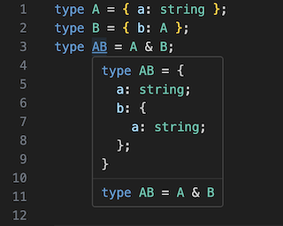

# Prettify TypeScript

**Get useful type information where you need it.**

[](https://marketplace.visualstudio.com/items?itemName=MylesMurphy.prettify-ts)
[](https://github.com/mylesmmurphy/prettify-ts)
[](https://marketplace.visualstudio.com/items?itemName=MylesMurphy.prettify-ts)
[](https://github.com/mylesmmurphy/prettify-ts/blob/main/LICENSE)

## Overview

Prettify TS is a Visual Studio Code extension that enhances your TypeScript development experience. It provides better hover previews for TypeScript types, classes, interfaces, and more, formatted in a more readable and highly configurable way.

## Example



## Watch This

<a href="https://www.youtube.com/shorts/9GRzNXKVa2o" target="_blank">
  
</a>

## Features

* **Prettified Type Hovers** – Enhanced and formatted hover displays for interfaces, aliases, functions, unions, arrays, and more.
* **Toggle Command** – Use `Toggle Preview` to quickly enable or disable prettified previews.
* **Copy Commands** – Use `Copy Prettified Type` or `Copy Fully Prettified Type` to grab the prettified result to your clipboard.
* **Highly Configurable** – Fine-tune output style, max depth, expansion behavior, and character limits.

## JavaScript Projects

Hover previews also work in JavaScript and JSX files using TypeScript's inferred types and JSDoc annotations. For configured projects, include JavaScript files with `allowJs` in `tsconfig.json`, or use a `jsconfig.json`.

## Requirements

VS Code 1.100.0 or newer. Workspace TypeScript 5.9 and the bundled compilers in the minimum/current editors are exercised by the test suites.

## Prerequisites for Vue Projects

To use Prettify TS with Vue projects, you need:

* **Vue.Volar extension** version **2.0.16** or higher
* **For Volar v2**: Add the following configuration to your VSCode settings:
  ```json
  {
    "vue.server.hybridMode": true
  }
  ```
* **For Volar v3**: No additional configuration required

## Extension Settings

| Setting                                 | Description                                                                                                                 |
| --------------------------------------- | --------------------------------------------------------------------------------------------------------------------------- |
| **Type Indentation**                    | Controls the indentation level of types.                                                                                    |
| **Max Depth**                           | Sets the maximum depth to which types should be expanded.                                                                   |
| **Max Properties**                      | Limits total properties and index signatures across the expansion. Omitted members are marked.                 |
| **Max Sub-Properties**                  | Limits the number of sub-properties (on nested objects) displayed for each property. Excess will be shown as ellipsis.      |
| **Max Union Members**                   | Limits the number of union members shown per union. Excess members will be displayed with ellipsis.                         |
| **Max Function Signatures**             | Limits the number of function signatures shown. Excess signatures will be replaced with ellipsis.                           |
| **Unwrap Functions**                    | If enabled, expands function parameter and return types.                                                                    |
| **Unwrap Arrays**                       | If enabled, expands the element types of arrays.                                                                            |
| **Unwrap Generic Arguments Type Names** | A list of generic type names whose arguments should be unwrapped instead of using their resolved output (e.g., `Promise`).  |
| **Hide Private Properties**             | Hides private/protected members, JavaScript private fields, and optionally underscore-prefixed members.                     |
| **Treat Underscore As Private**         | When hiding private members, also hides underscore-prefixed properties and methods. Defaults to enabled.                    |
| **Skipped Type Names**                  | List of type names that should not be expanded. Generics are supported and replaced with ellipses (e.g., `ZodObject<...>`). |
| **Max Characters**                      | Limits hover and regular copy characters. Full copy has independent safety limits.                                       |

To show public underscore-prefixed members while keeping private and protected members hidden, use:

```json
{
  "prettify-ts.hidePrivateProperties": true,
  "prettify-ts.treatUnderscoreAsPrivate": false
}
```

Private-member and underscore settings apply to hover previews and both copy commands. Disabling **Hide Private Properties** shows all members regardless of **Treat Underscore As Private**. Computed symbol keys remain visible unless the member is explicitly private or protected.

## Expansion and copy limits

Regular copy follows the same presentation settings as hover, including Max Characters. Copy Fully Prettified Type expands arrays/functions and relaxes depth/member limits, while preserving private-member filtering and explicit skipped names. Both commands show progress and support cancellation. Output clearly marks omitted members and budget-limited expansions.

All requests retain internal limits on nodes, recursion, time, type text, and response size. Full copy never disables these protections. Max Depth describes object-property nesting; it is separate from the hard traversal guard for functions, tuples, arrays, and generics.

Explicit skipped names take precedence over expansion settings. Array, Map, and Set are no longer skipped by default, so their expansion controls work consistently. Generic argument expansion supports aliases as well as interfaces/classes.

The legacy Unwrap Promises setting is deprecated: use Unwrap Generic Arguments Type Names. Setting the legacy option to false still preserves Promise references. Configuration can be overridden per folder and language; Toggle Preview updates the effective override.

Type display uses valid function/call/construct signature contexts and preserves generic binders, predicates, optional/readonly modifiers, explicit undefined, quoted keys, and readonly-array grouping. See the Prettify TS output channel for request failures.

## Sidebar View (Deprecated)

As of v0.1.0, Prettify TS focuses on hover previews only and no longer includes a sidebar Type View.

If you're looking for a sidebar-based type explorer, check out:

* [TypeScript Explorer](https://marketplace.visualstudio.com/items?itemName=mxsdev.typescript-explorer)
* [ts-type-expand](https://marketplace.visualstudio.com/items?itemName=kimuson.ts-type-expand)

## Contributing

Bug reports, suggestions, and pull requests are welcome. Visit [GitHub Issues](https://github.com/mylesmmurphy/prettify-ts/issues) to contribute.

## Acknowledgements

* [@mattpocock](https://github.com/mattpocock) – original inspiration via Prettify Type
* [@willbattel](https://github.com/willbattel) – early beta testing and feedback
* [@mattiamanzati](https://github.com/mattiamanzati) – TypeScript compiler insights

## License

[MIT](https://github.com/mylesmmurphy/prettify-ts/blob/main/LICENSE)
